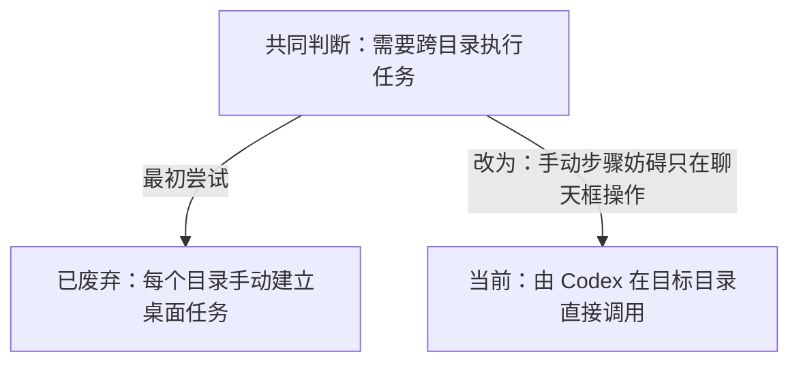
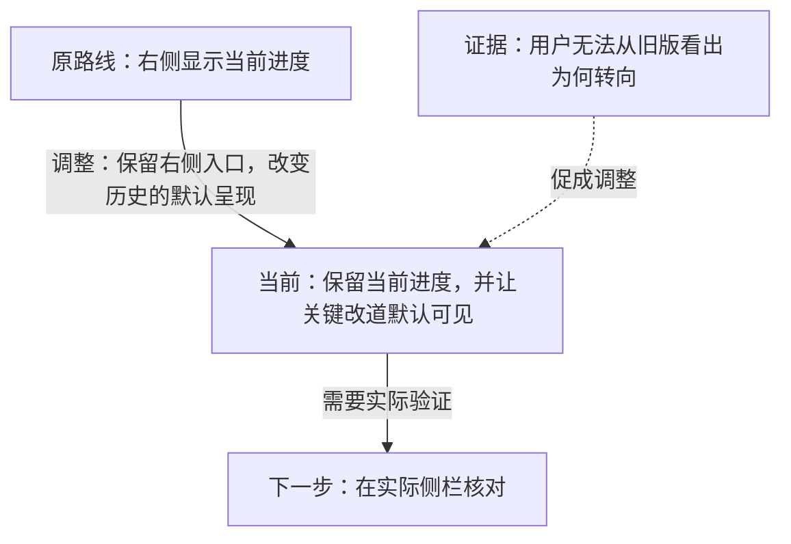

# 路线图语义

Mermaid 图保存判断的关系，不把聊天或执行日志全部画进去。节点写清对象、状态和判断；边写清用户决定、证据、风险或实现缺口如何造成推进或改道。样式只辅助阅读，状态在黑白或样式失效时仍要能从文字读懂。

## 分叉、修正与失败

放弃旧路线核心时，旧路线与新路线从最近的共同判断点分叉。不要画成“已废弃旧路线 → 新路线”，否则会误示新路线继承了旧路线的全部前提。

只调整做法或边界、仍保留原路线核心时，可以从原路线顺承到修正版，边上写清保留与改变的部分。失败直接触发修复且核心未变时，画出“失败证据 → 修复行动 → 重新验证”；证据未复核前不要标成功。

新路线只吸收旧路线的一部分，用写明“吸收”的虚线表示，不以主线连接冒充整体继承。证据、校准与边界作为旁挂节点，使用虚线连接到受其影响的路线，不伪装成路线推进。

图中可有多条当前路线，但每条都直接写“当前”。路线图反映真实逻辑关系；任务已有的编号可以作为查找线索，无需再发明一套深度加字母的用户可见编号。一张图看不清全局或连续路径时，用一张总图显示分叉，再用少量局部图展开，保持可从起点跟到当前节点。
