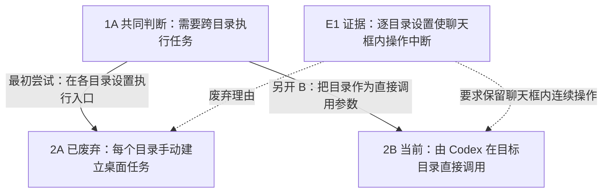
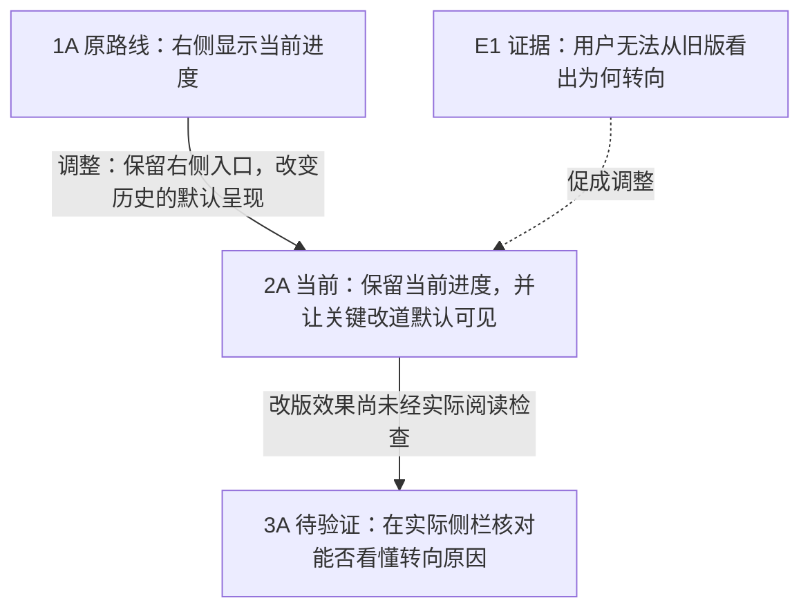

# 路线图的编号与表达

节点、联系、前提与分叉承载思考结构，图形是它的阅读视图。旧规范中的编号、分叉、修正与证据关系继续沿用；布局、展示范围和信息层次按人的理解需要调整。用户主要看图，图本身应能解释当前问题，不能默认把完整历史铺成大图，再要求读者通读正文。Mermaid 可作为可编辑图源，AI 也可直接检索同源文本记录，不依赖渲染。对象、状态、判断和关系含义写清，时间先后、推理支持、因果解释及决定变化分别表达。样式只辅助阅读，状态在黑白或样式失效时仍要能从文字读懂。

路线图是项目工作记录的关系入口。它应能让人和接手 agent 沿相关节点找回当时的问题、候选、行动、证据、判断与后续影响；细节在节点记录与原始来源中展开，不能只留下起点和最终方案。节点写得完整而联系缺失，仍无法恢复理解。概览展示当前阅读需要的关系，历史记录继续可查；关键联系不能只埋在长段正文或一份与图脱离的表格中。

## 节点编号与稳定定位

沿用旧文件的数字与字母编号方法。已有项目沿用其编号；新探索图使用下列约定，便于用户直接引用节点：

- 路线节点用 `1A`、`3B`、`12AA` 这样的“数字 + 路线字母”。数字表达问题结构的深度，字母表达路线，不把创建时间或工具调用次数当作深度。同路线深入沿用字母，真正另开路线使用不同字母，字母按 `A–Z、AA、AB…` 延展。
- 同一判断点产生的并列路线可以处于相同深度。深层发现暴露更高层问题时，新路线可返回相应结构深度；连线说明促成回看的证据或问题。回退动作本身无需额外造一个空节点。
- 证据、校准或原则、硬边界等旁挂信息分别用 `E1`、`C1`、`B1` 这样的“字母 + 数字”编号；它们不参加路线深度编号，也不伪装成路线的下一步。
- 每个路线节点只显示一个自身编号，不用 `1A–2A` 等范围编号压缩多个独立判断。编号在所属文档内唯一；跨任务引用带上文档入口，同一节点的尝试记录按时间或已有版本定位。
- 编号是可引用的身份。重排、改标题或折叠视图时保持原入口；结构重新理解导致可见编号确需改变时保留旧号映射，并使用稳定内部 ID 承接链接。不要为画面整齐全图重新编号，或将旧号分配给另一对象。

已有任务号、阶段号可以保留为材料索引，不能因此替换用户定义的路线编号。编号帮助查找，实际依赖和因果仍由节点内容与连线表达，不能只凭编号推断关系。

## 路线索引与定向翻阅

图的可编辑来源提供路线索引：路线字母或既有标识、名称、问题、起点、当前状态与节点记录入口。搜索某条路线即可找到其节点，沿显式上游链接理解目标、前提与过去尝试，并找到后续修正、关联证据和跨路线依赖。关系需要可从文字来源读取，不能只靠画面中的线或编号顺序推断。

节点标题概括具体对象、方法或结果；节点详情保存采用过的技术与工具、关键条件、尝试差异、实际结果及继续或放弃的原因，并链接准确文件与版本。节点详情可在同一文档，也可按稳定编号链接独立记录。只有总览和详情就应能理解重要工作的经过与当前状态，原件用于核实证据和检查实现。

记录增大时按核心问题或路线分开保存，由共同索引连接；不要求每次读取或预览整个项目。总览表达主要路线与关键依赖，局部图展开当前问题的节点和关系；跨出当前图的联系标明外部节点编号、作用与记录入口，进入任一端都能查回另一端。AI 先搜索定位，再沿关系读取必要记录；文本同样需要控制单次读取范围，不能以无需渲染为由堆成必须全文加载的大文件。精确关系图使用 Mermaid 或程序化绘图，保留可编辑图源；HTML 可以呈现该图源的视图，导出图像另附同源的可搜索记录；不维护一张包含全部历史的必读巨图，也不为渲染或篇幅删去有效关系。

## 节点粒度与连线

尚未弄清归属的观察、疑问和草图可先挂在当前路线的探索记录中，不强迫立即分成问题、立场和论据。理解逐渐形成后再整理节点与关系，保留原材料入口；正式决定、行动依据与交接成果仍应有稳定定位。

一个节点表达一个会影响路线判断的具体问题、行动、发现或结论。节点可写成“3B 待验证：并行来源是否互相覆盖”，让单独读到它的人也知道对象与当前判断。独立问题从共同判断点分开；同一节点的重复尝试在详情保存差异与结果，不以工具调用逐个造节点。

连线写清为什么继续、转向、修正或放弃，优先表达用户决定、证据、风险、实现缺口与条件变化，避免只写“继续推进”。候选只是先后被讨论、没有承接或吸收关系时，从共同判断点并列，不能用时间顺序冒充逻辑关系。

沿用实线表示推进、分叉或保留核心的修正，虚线表示证据、校准、边界和跨路线支持；也可采用其他清楚的编码，但保持这些关系可区分。当前、废弃、待验证等状态在文字中可见，样式辅助识别。可同时有多条当前路线，在入口说明当前组合。

## 前提、支持与变化

重要判断连接到实际支持它的前提和证据。几个条件共同支持结论时表达它们的共同作用，独立支持分别连接。节点详情提供可查找的关系两端、含义与依据；从结论能找前提，从前提能查受影响的决定。图与详情共用这些关系，不能用“见上文”“与某路线相关”代替具体连接。模型补入的关系标明依据与待验证部分，缺少的条件在相应位置可见。前提变化后，依据任务负责人重新核查的结果呈现受影响部分，保留仍成立的支持，并使旧判断、变化原因和当前判断能够互相定位。

## 分叉、修正与失败

放弃旧路线核心时，旧路线与新路线从最近的共同判断点分叉。不要画成“已废弃旧路线 → 新路线”，否则会误示新路线继承了旧路线的全部前提。

只调整做法或边界、仍保留原路线核心时，可以从原路线顺承到修正版，边上写清保留与改变的部分。失败直接触发修复且核心未变时，画出“失败证据 → 修复行动 → 重新验证”；证据未复核前不要标成功。

新路线只吸收旧路线的一部分，明确标出吸收的内容，避免表达成整体继承。局部继承可用写明“吸收内容”的虚线表示，证据、校准与边界作为旁挂节点，以虚线连接到受其影响的路线。下面的示例展示保留原路线核心后的修正。采用其他表达方式时，同样让这些关系与路线推进可区分。

## 当前结构与历史探索

设计已经收束或用户需要回忆整体机制时，从路线记录提取当前有效的结构图：关键对象、输入输出、用户可干预与系统自动处理的部分，以及会改变设计的硬边界。结构图是当前有效设计的视图，保留回到形成依据的节点引用；废弃路线留在历史中，不混入当前运行结构。代码接口等细节按它们对当前理解的作用放入局部图或资料。

图中保留会影响后续判断的失败、否决原因及其后续作用。相关节点可折叠到局部视图，但应能从概览定位，不能只把失败移到一份与路线无联系的表格。已验证成功但后来放弃的路线，同时保留验证范围与当前采用状态。

一张图看不清所需关系时，按阅读问题拆分或更换表达方式，保持总览、局部与来源可互相定位，不因图拥挤删除重要过程。图外说明补足非显然的边和必要条件，不重复抄写整张图。没有固定节点数或必须用一种图形的要求。

人读入口先回答当前最需要理解的问题，例如“为什么采用这个方案”或“几个模块如何配合”，选出解释它所必需的节点和关系。历史试错、实现细节和已经不影响当前判断的纠正留在可进入的记录中；仍决定当前选择的失败或边界必须在当前图可见。需要追问时，从节点展开对应局部图、关系理由或原件，返回时仍知道它在整体的位置。完整探索图可以保留为可选视图，不作为默认阅读负担；缩小字号、缩放整张巨图或删掉连线都不能代替内容取舍。

## 绘图检查

从一个当前判断回到共同判断点、尝试与证据，检查编号能否定位同一对象，节点是否被过度合并，连线是否准确表达否定、修正、支持和局部吸收；再定位一条失败路线及其影响。只看当前阅读范围的图，应能沿连线理解为什么形成当前选择，并找到继续深入的入口；只有节点而无有效联系不算完成。核对图、详情与实际产物使用同一组事实，计划与验证结果分开，当前结构只含有效设计。

恢复过度压缩的旧图时，从会话、旧版本、实际成果与验证材料补回独立改变判断的中间节点；缺少依据保持未知。使用实际成图检查连线归属、文字阅读和局部进入，按需要结合 `teach-and-explain` 检查理解与阅读。生图可参与页面风格或独立素材探索，精确节点、连线与编号仍由 Mermaid 或程序化图源承载，成图逐项核对这些关系和文字。
